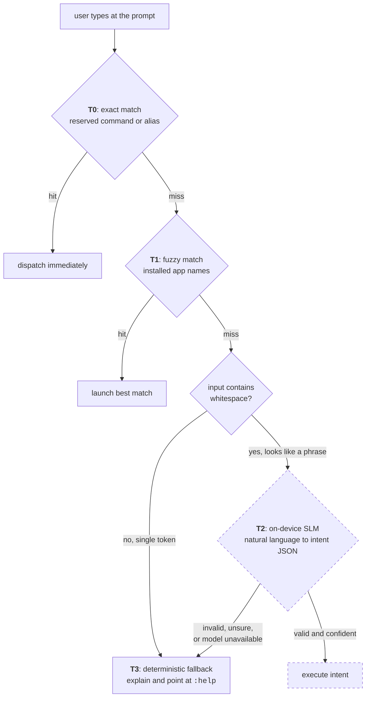

# Android launcher

!!! success "Shipped, and running as a real home screen"

    Installed on a Galaxy S20 FE from a signed release and set as the actual home screen, with a
    fallback launcher kept available. Launcher shell, command pipeline, app browser, aliases,
    notifications, notes, checklists and tasks are all built and verified on hardware.
    **650 automated tests**: 593 unit, 57 instrumented.

    Not built yet: the on-device model itself (tier T2), which is
    [a separate workstream](ml-pipeline.md).

The launcher replaces the Android home screen with a text prompt. No icon grid, no swipe-up drawer,
no widgets. You type what you want.

**Kotlin, Jetpack Compose, Room, single activity, min and target SDK 33.**

---

## The command cascade

Everything typed at the prompt falls through four tiers in order, stopping at the first that
produces an answer. This is the central design decision in the application.



T2 is dashed because it does not exist yet, and the launcher is fully usable without it. The model
is one tier of a cascade, never a dependency of the home screen. If the weights are missing, still
downloading, or produce garbage, input falls to T3 and the user gets a real answer instead of a
spinner or a crash.

Every submitted line is logged locally with what the tiers did to it, which is what turns daily use
into the fine-tuning set. That logging shipped before the launcher became a daily driver, on
purpose: usage that happens before the log exists cannot be recovered. It records the resolution rather than an intent label, because the label
space is expected to move before the dataset is frozen. Misses are logged too: input nothing could
resolve is exactly the material for teaching the model to say it does not know. The log never leaves
the device.

The gate between T2 and T3 is crude on purpose. Input containing whitespace looks like a phrase and
is worth sending to a model; a single unmatched token almost never is. The cheap check avoids
waking an LLM to reject the word `asdf`.

### Tier 0: reserved commands

| Command | Does |
|---|---|
| `:apps [query]` | Browse and launch apps, filtering live as you type |
| `:notes [query]` | Browse and search notes |
| `:note [name]` | Open or create a note by name |
| `:task <text>` | Add a due-dated task |
| `:tasks` | What is outstanding, soonest first |
| `:tasksdone` | What has been completed |
| `:alias` | List defined aliases |
| `:notif` | Browse notifications |
| `:settings` | Open system settings |
| `:help` or `?` | Command reference |

Commands are registered in a table carrying their own help text, so help output cannot drift from
the set of commands that exist.

### Tier 1: fuzzy app matching

An in-memory index built from `PackageManager`, matched with edit distance plus prefix and
substring scoring. Best match always wins, with no "did you mean" prompt. A wrong guess costs one
keystroke to correct; a confirmation prompt costs a tap every time.

---

## Notes and checklists

A complete notes system on Room, designed from the start for two clients in two languages.

### Markdown is the storage format

Notes are Markdown text. Checklists are `- [ ]` and `- [x]` lines inside the note body. No items
table, no rich-text document model.

The checklist editor gets its items by parsing the body on every read and writes them straight
back. Nothing is cached alongside the body, so there is no second copy that can drift from it:

```kotlin
val items: List<ChecklistItem> get() = draft?.let { parseChecklist(it.body) }.orEmpty()
```

Re-parsing on every read costs a few string operations on a grocery list. In exchange, "the body
and the item list disagree" stops being a state the program can reach.

The same reasoning drove
[ADR-0004](https://github.com/flambeauRiverTours/dailyDriver/blob/main/docs/adr/0004-markdown-over-rich-text-json.md).
A rich-text model like Quill Delta would need matching implementations in Kotlin and C#, and any
difference between them would corrupt notes with nothing visible on screen. With Markdown you can
see the damage.

### One contract, two languages

Kotlin and C# both parse the same note bodies, and they have to agree exactly. A difference would
not throw an error. It would quietly reorder someone's grocery list between their phone and their
desktop.

Neither language owns the rules. They live in JSON fixture files that both test suites run:

```
fixtures/tag-parsing.json
fixtures/checklist-parsing.json
```

Each file carries the rules in prose, the known limits, and the cases for parsing, rendering,
conversion and normalisation. Both implementations run those examples, so a divergence fails a test
before it reaches a user. The files also record what the format deliberately does not do, such as
flattening nested checklists, so a future implementer can tell a design limit from a bug.

### What the editor does

- Inline overlay over the CLI surface, growing as you write, autosaving on a 500 ms debounce.
- Checklist mode: add, tick, delete, drag to reorder by a handle.
- Ticking an item moves it below the unticked ones. That ordering is an invariant reapplied after
  every change, so a drag cannot produce a state that ticking a box could not.
- Convert between prose and checklist in either direction, and hide completed items.
- `#hashtag` parsing, a tag chip row, and local full-text search. Chips edit the hashtags in the
  body rather than writing tags anywhere else, so there is still one writer.
- Undo for anything destructive: discarding a note, deleting a row, converting between types.
  Discard used to ask for confirmation, which is what you do when you cannot undo. Now it just
  acts, and offers the note back.
- Enter on a trailing empty checklist row finishes the note, so a list can be completed without
  reaching for the screen.

### Tasks

A task is a checklist item with a due date, written as an `@YYYY-MM-DD` token in the body next to
the hashtags. There is no tasks table you can edit and no separate task type, so `:task buy milk
@fri` and typing a date onto an existing checklist row produce identical lines.

You type dates the short way. `@tomorrow`, `@next week`, `@t+3`, `@w+2` all resolve to a real date
the moment the row is committed, so what gets stored is always a literal date and a note means the
same thing next week as it does today.

Querying goes through a derived index: a `tasks` table with an indexed date column, written only by
deriving it from a note body inside the same transaction as the note write. It is rebuildable from
scratch and never syncs. "What is due today" is the question the feature exists to answer, and it
should not require reading every note to answer it. The same pattern already indexes hashtags.

### Sync foundations

The schema carries a transactional outbox. A note edit and its outbound sync record are written in
one transaction, so a write cannot be saved locally while its sync intent is lost. Both live in a
single SQLite database, because a transaction cannot span two files.

Instrumented tests validated that immediately. They caught `INSERT OR REPLACE` on a note silently
cascade-deleting its pending outbox row, which would have dropped edits with no error anywhere.

---

## Other built surfaces

**Notifications.** A `NotificationListenerService` feeding a browsable list, with an unread
indicator in the status row.

**Aliases.** User-defined shortcuts resolved at T0, stored in Room. A target is checked against
the installed apps before it is stored, and an ambiguous one is refused rather than guessed.

**Status row.** Clock, date, battery level and unread-notification dot, in immersive fullscreen
with both system bars hidden.

---

## Testing

593 unit tests on the JVM covering parsing, matching, view models and formatting. 57 instrumented
tests covering Room, migrations and schema export. Room's exported schema is diffed against the
compiled entities by a test, so a schema change without a migration fails the build instead of
corrupting a database in the field.

Three bugs in the checklist editor passed all of that, plus lint, and only turned up on hardware: a
drag gesture losing silently to the text field's own long-press handler, a layout that pushed the
action row off screen, and a focus request that failed without throwing, so a new row appeared but
could not be typed into. Device verification counts as part of finishing a feature here.
