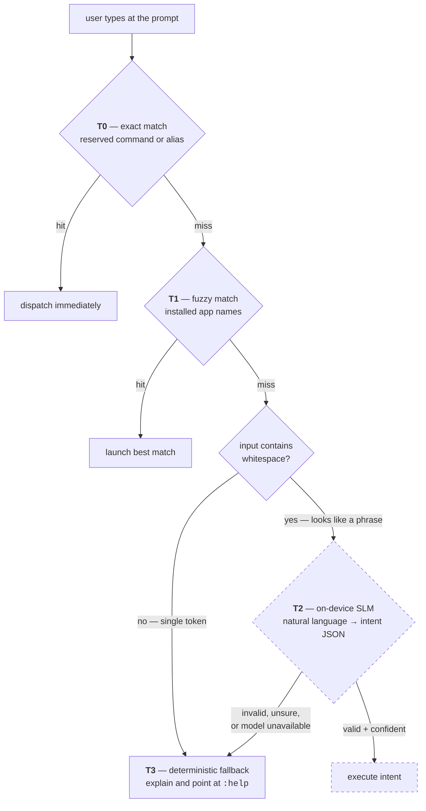

# Android launcher

!!! success "Working — runs as a real home screen"

    The launcher shell, command pipeline, app browser, aliases, notifications and the entire notes
    and checklist system are implemented and verified on hardware (Galaxy S20 FE) and emulator.
    **540 automated tests** — 508 unit, 32 instrumented.

    Not yet built: the on-device model itself (tier T2), which is
    [its own workstream](ml-pipeline.md).

The launcher replaces the Android home screen with a text prompt. There is no icon grid, no
swipe-up drawer, no widgets — you type what you want.

**Kotlin · Jetpack Compose · Room · single-activity · min/target SDK 33**

---

## The command cascade

Everything typed at the prompt falls through four tiers, in order, stopping at the first that
produces an answer. This is the central design decision of the whole application.



**T2 is dashed because it does not exist yet — and the launcher is fully usable regardless.**
That is the point of the structure. The model is one tier of a cascade, never a dependency of the
home screen. If the weights are missing, still downloading, or produce garbage, input falls to T3
and the user gets a real answer instead of a spinner or a crash.

The T2/T3 gate is deliberately crude: input containing whitespace looks like a phrase and is worth
sending to a model; a single unmatched token almost certainly isn't. A cheap heuristic here avoids
waking an LLM to reject the word `asdf`.

### Tier 0 — reserved commands

Seven commands, all implemented:

| Command | Does |
|---|---|
| `:apps [query]` | Browse and launch apps, filtering live as you type |
| `:notes [query]` | Browse and search notes |
| `:note [name]` | Open or create a note by name |
| `:alias` | List defined aliases |
| `:notif` | Browse notifications |
| `:settings` | Open system settings |
| `:help` / `?` | Command reference |

Commands are registered in a table that carries its own help text, so the help output cannot
drift from the set of commands that actually exist — a class of bug that only shows up when
someone reads the docs and finds a command missing.

### Tier 1 — fuzzy app matching

An in-memory index built from `PackageManager`, matched with edit distance and prefix/substring
scoring. **The best match always wins; there is no ambiguity prompt.** A launcher that stops to
ask "did you mean…" is slower than the icon grid it replaced. Being occasionally wrong and
instantly correctable beats being always right and slow.

---

## Notes and checklists

A complete notes system on Room, designed from the start for two clients in two languages.

### Markdown is the storage format

Notes are Markdown text. Checklists are `- [ ]` and `- [x]` lines **inside the note body** — there
is no items table, and no rich-text document model.

The checklist editor derives its items by parsing the body on every read and writes them straight
back. Nothing is cached alongside the body, so there is no second copy that can drift from it:

```kotlin
val items: List<ChecklistItem> get() = draft?.let { parseChecklist(it.body) }.orEmpty()
```

Re-parsing on every read costs a handful of string operations on a grocery list. What it buys is
that "the body and the item list disagree" is not a state the program can enter.

The same reasoning drove [ADR-0004](https://github.com/flambeauRiverTours/dailyDriver/blob/main/docs/adr/0004-markdown-over-rich-text-json.md):
a rich-text model (Quill Delta, ProseMirror) would need identical implementations in Kotlin and
C#, and divergence between them would corrupt notes invisibly. Markdown divergence is visible.

### What the editor does

- Inline overlay over the CLI surface — grows as you write, autosaves on a 500 ms debounce
- Checklist mode: add, tick, delete, drag-reorder by handle
- Ticking an item moves it below the unticked ones, and that ordering is an invariant re-applied
  after every mutation — so a drag cannot produce a state ticking a box couldn't
- Convert between prose and checklist in either direction
- Hide completed items
- `#hashtag` parsing for organisation, local full-text search

### Sync foundations, already in place

The schema carries a **transactional outbox**: a note edit and its outbound sync record are
written in one transaction, so a write can't be persisted locally while its sync intent is lost.
Both live in a single SQLite database because a transaction can't span two files.

That decision was validated by instrumented tests immediately — they caught `INSERT OR REPLACE`
on a note silently cascade-deleting its pending outbox row, which would have dropped edits on the
floor with no error anywhere.

---

## Other implemented surfaces

**Notifications** — a `NotificationListenerService` feeding a browsable list, with an unread
indicator in the status row.

**Aliases** — user-defined shortcuts resolved at T0, stored in Room.

**Status row** — clock, date, unread-notification dot, in immersive fullscreen with both system
bars hidden.

---

## Testing

| Suite | Count | Runs on |
|---|---|---|
| Unit (JVM) | 508 | Every build |
| Instrumented (Room, migrations) | 32 | Emulator/device |

Room's schema is exported and diffed against the compiled entities by a test, so a schema change
that isn't accompanied by a migration fails the build rather than corrupting a database in the
field.

**Three bugs in the checklist editor were found only by running it on hardware**, and none were
reachable from unit tests: a drag gesture silently losing to the text field's own long-press
handler, a layout that pushed the action row off-screen, and a focus request that failed *quietly*
so a newly added row appeared but couldn't be typed into. They're written up in the
[task log](https://github.com/flambeauRiverTours/dailyDriver/blob/main/docs/tasks.md) — device
verification is treated as part of "done", not as a formality.
