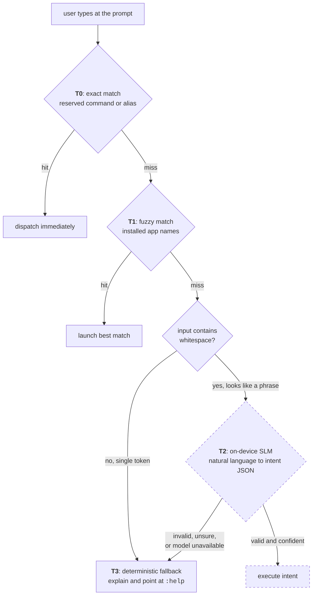

# Android launcher

!!! success "Working, and running as a real home screen"

    The launcher shell, command pipeline, app browser, aliases, notifications and the whole notes
    and checklist system are built and verified on hardware (Galaxy S20 FE) and emulator.
    **540 automated tests**: 508 unit, 32 instrumented.

    Not built yet: the on-device model itself (tier T2), which is
    [a separate workstream](ml-pipeline.md).

The launcher replaces the Android home screen with a text prompt. There is no icon grid, no
swipe-up drawer and no widgets. You type what you want.

**Kotlin, Jetpack Compose, Room, single activity, min and target SDK 33.**

---

## The command cascade

Everything typed at the prompt falls through four tiers in order, stopping at the first one that
produces an answer. This is the central design decision in the application.



T2 is drawn with a dashed border because it does not exist yet, and the launcher is fully usable
without it. The model is one tier of a cascade and never a dependency of the home screen. If the
weights are missing, still downloading, or produce garbage, input falls through to T3 and the user
gets a real answer instead of a spinner or a crash.

The gate between T2 and T3 is deliberately crude. Input containing whitespace looks like a phrase
and is worth sending to a model. A single unmatched token almost never is. The cheap check here
avoids waking an LLM to reject the word `asdf`.

### Tier 0: reserved commands

Seven commands, all built:

| Command | Does |
|---|---|
| `:apps [query]` | Browse and launch apps, filtering live as you type |
| `:notes [query]` | Browse and search notes |
| `:note [name]` | Open or create a note by name |
| `:alias` | List defined aliases |
| `:notif` | Browse notifications |
| `:settings` | Open system settings |
| `:help` or `?` | Command reference |

Commands are registered in a table that carries its own help text, so the help output cannot drift
from the set of commands that exist. That kind of bug only surfaces when someone reads the docs
and finds a command missing.

### Tier 1: fuzzy app matching

An in-memory index built from `PackageManager`, matched with edit distance plus prefix and
substring scoring. The best match always wins and there is no "did you mean" prompt. A launcher
that stops to ask is slower than the icon grid it replaced. A wrong guess costs one keystroke to
correct; a confirmation prompt costs a tap every single time.

---

## Notes and checklists

A complete notes system on Room, designed from the start for two clients in two languages.

### Markdown is the storage format

Notes are Markdown text. Checklists are `- [ ]` and `- [x]` lines inside the note body. There is
no items table and no rich-text document model.

The checklist editor gets its items by parsing the body on every read, and writes them straight
back. Nothing is cached alongside the body, so there is no second copy that can drift from it:

```kotlin
val items: List<ChecklistItem> get() = draft?.let { parseChecklist(it.body) }.orEmpty()
```

Re-parsing on every read costs a handful of string operations on a grocery list. In exchange,
"the body and the item list disagree" stops being a state the program can reach.

The same reasoning drove
[ADR-0004](https://github.com/flambeauRiverTours/dailyDriver/blob/main/docs/adr/0004-markdown-over-rich-text-json.md).
A rich-text model like Quill Delta or ProseMirror would need matching implementations in Kotlin
and C#, and any difference between them would corrupt notes with nothing visible on screen. With
Markdown you can see the damage.

### What the editor does

- Inline overlay over the CLI surface. It grows as you write and autosaves on a 500 ms debounce.
- Checklist mode: add, tick, delete, and drag to reorder by a handle.
- Ticking an item moves it below the unticked ones. That ordering is an invariant reapplied after
  every change, so a drag cannot produce a state that ticking a box could not.
- Convert between prose and checklist in either direction.
- Hide completed items.
- `#hashtag` parsing for organisation, and local full-text search.

### Sync foundations, already in place

The schema carries a transactional outbox. A note edit and its outbound sync record are written in
one transaction, so a write cannot be saved locally while its sync intent is lost. Both live in a
single SQLite database, because a transaction cannot span two files.

Instrumented tests validated that decision immediately. They caught `INSERT OR REPLACE` on a note
silently cascade-deleting its pending outbox row, which would have dropped edits on the floor with
no error anywhere.

---

## Other built surfaces

**Notifications.** A `NotificationListenerService` feeding a browsable list, with an unread
indicator in the status row.

**Aliases.** User-defined shortcuts resolved at T0, stored in Room.

**Status row.** Clock, date and unread-notification dot, in immersive fullscreen with both system
bars hidden.

---

## Testing

| Suite | Count | Scope |
|---|---|---|
| Unit (JVM) | 508 | Parsing, matching, view models, formatting |
| Instrumented (Room, migrations) | 32 | Emulator and device |

Room's schema is exported and diffed against the compiled entities by a test, so a schema change
without a migration fails the build instead of corrupting a database in the field.

Three bugs in the checklist editor were found only by running it on hardware, and none were
reachable from unit tests: a drag gesture losing silently to the text field's own long-press
handler, a layout that pushed the action row off screen, and a focus request that failed without
throwing, so a newly added row appeared but could not be typed into. All three are written up in
the [task log](https://github.com/flambeauRiverTours/dailyDriver/blob/main/docs/tasks.md). Device
verification counts as part of finishing a feature here.
