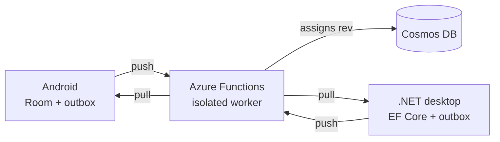

# Azure backend

!!! warning "Partly built. The shared contract is real; the Functions app is not written yet."

    `backend/Notes.Shared` is built and covered by tests: the DTOs, tag parsing, checklist parsing,
    due-date rules and the task index, all executing the same `fixtures/` corpus as the Android
    suite. The Functions app and the Bicep infrastructure are designed but not written. Everything
    below describing HTTP endpoints, Cosmos or sync is design, not code. This page gets rewritten
    as it lands.

A C# Azure Functions backend that stores notes in Cosmos DB and arbitrates sync between the Android
launcher and the WPF desktop client.

**Planned stack:** C# Azure Functions (isolated worker), Cosmos DB NoSQL, Bicep IaC, on a fixed
$0/month budget. Infrastructure is defined in Bicep so the environment rebuilds from source with no
clicking through a portal.

---

## Two constraints that are easy to get wrong

**Isolated worker model, never in-process.** In-process support for Azure Functions ends on
**10 November 2026**. Most tutorials and Stack Overflow answers predate that and demonstrate the
model being retired.

**Cosmos DB provisioned throughput, not serverless.** The free tier requires provisioned-throughput
capacity mode, selectable only when the account is created. Choosing serverless, which sounds right
sitting next to "Azure Functions", forfeits the free tier permanently. Fixing it means destroying
the account and starting again.

---

## Sync model

Local-first. Each client owns an authoritative local database and a transactional outbox, and the
server assigns ordering.

Both clients push their outbox to the Functions app, which assigns a revision number and writes to
Cosmos. Clients pull changes since the last revision they saw.

**Revisions are assigned by the server.** Ordering does not depend on device clocks, so a phone set
an hour ahead cannot win a conflict it should have lost.

**Conflicts produce copies.** When two devices edit the same note offline, the higher revision keeps
the name and the loser is saved as a conflict copy, an ordinary note the user can read and merge.
Plain last-write-wins is simpler and quietly destroys work. Reasoning in
[ADR-0005](https://github.com/flambeauRiverTours/dailyDriver/blob/main/docs/adr/0005-conflict-copies-over-plain-lww.md).

### Correctness scenarios

Specified as pass/fail cases, to be automated in xUnit against an in-memory harness:

| Scenario | Expectation |
|---|---|
| Edit offline on one client | Converges on reconnect, no conflict copy |
| Edit offline on both, same note | Higher `rev` wins, loser saved as a conflict copy |
| Delete on one, edit on the other | Tombstone wins, edited version preserved |
| Sync interrupted mid-push | Outbox replays, no duplicates and no lost writes |
| Device clock an hour ahead | Ordering unaffected, since `rev` is server-assigned |
| Shared fixture corpus | Kotlin and C# produce identical parses |

---

## Planned API

A small REST surface over Cosmos: push a batch of outbox entries, pull changes since a known
revision, and resolve conflicts server-side. Authentication is deferred on purpose, since a
single-user project does not need identity infrastructure before it has working sync.
