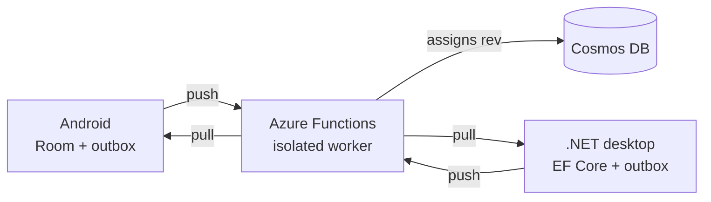

# Azure backend

!!! warning "Not started — design complete, code is a scaffold"

    `backend/Notes.Functions` and `backend/Notes.Shared` are empty project files. The API surface,
    document model and sync semantics below are **designed and decided, not built**. This page will
    be rewritten as it lands.

A C# Azure Functions backend that stores notes in Cosmos DB and arbitrates sync between the
Android launcher and the WPF desktop client.

**Planned stack:** C# Azure Functions (isolated worker) · Cosmos DB NoSQL · Bicep IaC ·
fixed $0/month budget

---

## Two constraints that are easy to get wrong

Both are recorded as hard constraints because the common answer is the wrong one:

**Isolated worker model, never in-process.** In-process support for Azure Functions ends
**10 November 2026**. The majority of tutorials and Stack Overflow answers predate that and
demonstrate the model that is being retired.

**Cosmos DB provisioned throughput, not serverless.** The free tier requires provisioned-throughput
capacity mode, and that mode is selectable **only at account creation**. Choosing serverless — the
option whose name sounds correct next to "Azure Functions" — silently forfeits the free tier
permanently, and cannot be corrected without destroying and recreating the account.

---

## Sync model

Local-first. Each client owns an authoritative local database and a transactional outbox; the
server assigns ordering.

**Revisions are assigned by the server, not the client.** Ordering therefore doesn't depend on
device clocks — a phone set an hour ahead cannot win a conflict it should have lost. Clock skew as
a correctness bug is designed out rather than tolerated.

**Conflicts produce copies, not casualties.** When two devices edit the same note offline, the
higher revision wins the name and the loser is preserved as a conflict copy — an ordinary note the
user can read and merge. Plain last-write-wins is simpler and quietly destroys work; the reasoning
is in [ADR-0005](https://github.com/flambeauRiverTours/dailyDriver/blob/main/docs/adr/0005-conflict-copies-over-plain-lww.md).

### Correctness scenarios

Sync is specified as pass/fail cases rather than a metric, to be automated in xUnit against an
in-memory harness:

| Scenario | Expectation |
|---|---|
| Edit offline on one client | Converges on reconnect, no conflict copy |
| Edit offline on both, same note | Higher `rev` wins; loser preserved as a conflict copy |
| Delete on one, edit on the other | Tombstone wins; edited version preserved |
| Sync interrupted mid-push | Outbox replays — no duplicates, no lost writes |
| Device clock an hour ahead | Ordering unaffected — `rev` is server-assigned |
| Shared fixture corpus | Kotlin and C# produce identical parses |

---

## Planned API

A small REST surface over Cosmos: push a batch of outbox entries, pull changes since a known
revision, and resolve conflicts server-side. Authentication is deferred deliberately — a
single-user personal project doesn't need identity infrastructure before it needs working sync.

Infrastructure is defined in Bicep so the whole environment is reproducible from source rather
than assembled by clicking through a portal.
