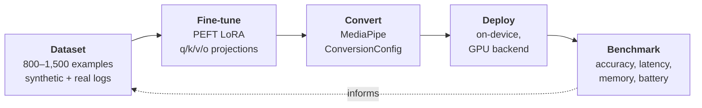

# On-device ML pipeline

!!! warning "Not started — design, model shortlist and evaluation plan complete"

    No training or inference code exists yet. The launcher's [T2 tier](android.md#the-command-cascade)
    is the slot this fills, and the launcher runs without it today. This page will be rewritten as
    it lands.

Turning natural language typed at the prompt — *"remind me to call the dentist tomorrow"* — into
structured intent JSON, entirely on the phone, with no network call.

**Planned:** Gemma-2 2B / Gemma-3 1B · PEFT LoRA · MediaPipe converter · MediaPipe LLM Inference
(GPU backend)

---

## The pipeline

Five stages, each with its own deliverable: **build the dataset** (800–1,500 examples, synthetic
generation plus hand-labelled real usage logs) → **fine-tune** a LoRA adapter with PEFT against the
attention projections → **convert** it for on-device use with MediaPipe's converter → **deploy** to
the phone on the GPU backend → **benchmark** against the baselines below. Benchmark results feed
back into the dataset.

Real usage feeds the dataset: the launcher logs T0 and T1 hits, which become hand-labelled
training examples. That's why instrumentation is scheduled to land **before** the launcher becomes
a daily driver — every day of use without it throws away data the model needs.

---

## Structured output without grammar constraints

MediaPipe has no grammar-constrained decoding — unlike llama.cpp's GBNF, it cannot be forced to
emit valid JSON. Schema adherence is therefore probabilistic and has to be defended in layers:

1. Tight few-shot prompt with the schema inline
2. Low temperature (~0.1 — this is extraction, not writing)
3. Extract the first balanced `{...}` span from the output
4. Repair pass: trailing commas, unquoted keys, markdown fences
5. Validate against the schema; on failure *or* low confidence, fall through to T3

**Making step 5 fire rarely is the entire justification for fine-tuning.** The fallback is what
makes the feature safe to ship; the fine-tune is what makes it good.

---

## Evaluation is the deliverable

The benchmark table is treated as a more important artifact than the app itself, and includes
results where the fine-tune *loses*.

| Metric | Method |
|---|---|
| Intent accuracy, per-intent F1 | Held-out test set, frozen before tuning |
| Slot exact-match | Held-out test set |
| Schema-valid JSON rate | Measured pre- and post-repair |
| Abstention quality | False-positive rate on out-of-scope inputs |
| Time-to-first-token, tokens/sec | On-device, instrumented |
| Peak memory during inference | `adb shell dumpsys meminfo` |
| Battery and thermal behaviour | Sustained 50-command loop |

Three baselines are compared: the deterministic parser alone, the base model with few-shot
prompting, and the fine-tuned model. Reporting the cases where the simpler approach wins is the
point — an evaluation that can only confirm the decision already made isn't an evaluation.

---

## Known risks, accepted deliberately

**MediaPipe is in maintenance mode.** Google has directed new work to LiteRT-LM. The design uses
MediaPipe anyway, but *all* inference sits behind an `InferenceEngine` interface so a
`LiteRtLmEngine` can replace it without touching the command pipeline. Doing that migration and
benchmarking both backends is a worthwhile result in itself, budgeted as a v2 milestone rather
than handled as an emergency. Reasoning in
[ADR-0003](https://github.com/flambeauRiverTours/dailyDriver/blob/main/docs/adr/0003-mediapipe-over-llama-cpp.md).

**LoRA support is experimental and constrains model choice.** MediaPipe requires the GPU backend,
applies adapters to attention layers only, and documents compatibility for a short list of models.
Gemma-2 2B is explicitly documented; Gemma-3 1B is smaller and faster but its LoRA support is not
clearly stated.

**This is gated on a timeboxed spike, not assumed.** The first question is whether a LoRA adapter
loads on the GPU backend on the target device at all. If it doesn't, the fallback is few-shot
prompting with a stricter repair pass — and the result becomes "evaluated fine-tuning, shipped the
alternative, with numbers." Decided on evidence rather than abandoned at the first error.
