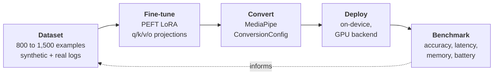

# On-device ML pipeline

!!! warning "Not started. There is no model, no dataset and no training pipeline yet."

    What does exist is the code that will sit around the model: the inference interface, and the
    five-layer defence that turns whatever the model emits into validated intent JSON or refuses
    it. Those are built and tested against deliberately malformed output. The MediaPipe runtime
    is in the app now, along with the class that will drive it, although nothing calls that class
    yet. Collection of real training data has also been running on the phone since August. This
    fills the launcher's [T2 tier](android.md#the-command-cascade), and the launcher runs
    without it today. This page gets rewritten as the rest lands.

Turning natural language typed at the prompt, like *"remind me to call the dentist tomorrow"*, into
structured intent JSON. All of it on the phone, with no network call.

**Planned:** a Gemma model in the 270M to 2B range, PEFT LoRA or a full fine-tune depending on
which model wins, MediaPipe converter, MediaPipe LLM Inference on the GPU backend.

Model selection is still open and is being decided on measurement rather than on preference. The
project sets itself a budget of under 1.5 GB resident during inference, and that budget is what
narrowed the field: the largest candidate is published only at 8-bit and would need close to twice
that. Smaller models fit easily but most of them cannot take a LoRA adapter under this runtime.
That used to rule them out. It no longer does, because the tuned model is no longer what
guarantees valid output, so the remaining question is what accuracy a small model reaches on a
closed set of eighteen intents. The work to answer that is scheduled before any training starts.

---

## The pipeline

Build the dataset from synthetic generation plus hand-labelled real usage logs. Fine-tune a LoRA
adapter with PEFT against the attention projections. Convert it with MediaPipe's converter. Deploy
to the phone on the GPU backend. Benchmark against the baselines below, and feed the results back
into the dataset.

The launcher logs T0 and T1 hits, and those become training examples. That is why instrumentation
lands before the launcher becomes a daily driver: every day of use without it throws away data the
model needs.

The first month of that log came off the phone in September: 261 distinct commands covering 1,116
uses, across 27 days of the launcher being somebody's actual home screen. Reviewing it changed
the plan in three ways. Two commands turned out to have no intent label, one of them the second
most used in the log. Two labels can never be collected this way at all, because they describe
tapping a checklist item rather than typing. And the real misses, the inputs the deterministic
tiers could not resolve, came to three examples of one kind, so the out-of-scope set that
abstention gets measured against has to be written rather than harvested. Finding that now is the
reason the log was built before the launcher shipped.

---

## Structured output

The runtime can be told to emit only output that fits a given shape. The list of eighteen commands
would become a fixed set of allowed values, so the model could not name a nineteenth one, and the
fields carrying the details would be typed. That turns malformed output from unlikely into
impossible. *Planned, and not yet built.*

This was not the original plan, and this page said the opposite until September 2026. The capability
turned out to exist in a companion library rather than the main one, which took a read of the
shipped code to find. The five layers below were built to survive output that could not be trusted,
and they are kept as the fallback for the cases where the constraint cannot be applied:

1. Tight few-shot prompt with the schema inline. *Planned.*
2. Low temperature, around 0.1, since this is extraction and not writing. *Planned.*
3. Extract the first balanced `{...}` span from the output. **Built.**
4. Repair pass for trailing commas, unquoted keys and markdown fences. **Built.**
5. Validate against the schema. On failure or low confidence, fall through to T3. **Built.**

Layers three to five are finished and covered by 33 tests, including output carrying a markdown
fence, surrounding prose, an unquoted key, a trailing comma and smart quotes at once. They were
built before the model because they are what makes a bad answer safe, and because none of them
need one to be tested. A repair pass is only allowed to fix syntax: it will not invent a missing
confidence score, because that score is what the decision to abstain rests on.

The fallback is what makes the feature safe to ship.

This page used to say that getting step 5 to fire rarely was the whole reason to fine-tune. With a
constrained decoder that step cannot fire at all, so the reason has been restated. Fine-tuning is
now measured rather than assumed: the tuned model is compared against an untuned one running under
the same constraint, on a held-out set frozen before any training, and the one that scores better
is the one that ships. Both numbers get published either way.

---

## Evaluation is the deliverable

The benchmark table matters more than the app, and it includes the results where the fine-tune
loses.

| Metric | Method |
|---|---|
| Intent accuracy, per-intent F1 | Held-out test set, frozen before tuning |
| Slot exact-match | Held-out test set |
| Schema-valid JSON rate | Measured before and after the repair pass |
| Abstention quality | False-positive rate on out-of-scope inputs |
| Time-to-first-token, tokens/sec | On-device, instrumented |
| Peak memory during inference | `adb shell dumpsys meminfo` |
| Battery and thermal behaviour | Sustained 50-command loop |

Three baselines get compared: the deterministic parser alone, the base model with few-shot
prompting, and the fine-tuned model. Reporting the cases where the simpler approach wins is the
point of running it.

---

## Known risks, accepted on purpose

**MediaPipe is in maintenance mode.** Google has directed new work to LiteRT-LM. The design uses
MediaPipe anyway, but all inference sits behind an `InferenceEngine` interface, so a
`LiteRtLmEngine` can replace it without touching the command pipeline. Migrating and benchmarking
both backends is a useful result on its own, budgeted as a v2 milestone. Reasoning in
[ADR-0003](https://github.com/flambeauRiverTours/dailyDriver/blob/main/docs/adr/0003-mediapipe-over-llama-cpp.md).

**LoRA support is experimental and constrains model choice.** MediaPipe requires the GPU backend,
applies adapters to attention layers only, and documents compatibility for a short list of models.
Gemma-2 2B is explicitly documented. Gemma-3 1B is smaller and faster but its LoRA support is not
clearly stated.

**This is gated on a timeboxed spike.** The first question is whether a LoRA adapter loads on the
GPU backend on the target device at all. If it does not, the fallback is few-shot prompting with a
stricter repair pass, and the result becomes "evaluated fine-tuning, shipped the alternative, with
numbers". Decided on evidence.
